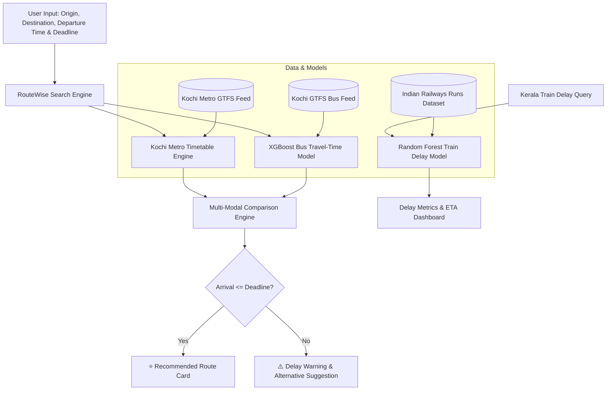

# 🚌 RouteWise AI

> **AI-Based Bus & Train ETA Prediction and Route Optimization**  
> *Machine Learning Project • B.Tech Electrical & Electronics Engineering (EEE)*  
> **Contributors:** Vishnu Narayan A B (Roll 61) & Vivek Noorudheen (Roll 62)

[](https://www.python.org/)
[](https://streamlit.io/)
[](https://xgboost.readthedocs.io/)
[](https://scikit-learn.org/)
[](https://www.docker.com/)

---

## 📌 Overview

Passengers often need to reach important destinations (such as Cochin International Airport, railway junctions, or office hubs) within strict time limits. Fixed transit schedules fail to reflect real-world bottlenecks, rush hours, weather patterns, and operational delays. 

**RouteWise AI** is an intelligent mobility platform that unites multi-modal transit options across Kochi and Kerala. It combines **Extreme Gradient Boosting (XGBoost)** and **Random Forest regression** models to predict accurate travel times and delay risks, recommending the optimal route that guarantees arrival before the passenger's deadline.

---

## 🌟 Key Features

1. **🚌 🚇 Multi-Modal Journey Planner (Kochi)**
   - Simultaneously searches **465 Kochi bus routes** and all **25 Kochi Metro (KMRL Line 1)** stations.
   - Computes ML travel time per segment accounting for rush hours and time-of-day traffic patterns.
   - Compares predicted arrival times against user deadlines to surface an instant **⭐ Recommended Route**.

2. **🚆 Kerala Train Delay & ETA Predictor**
   - Trained on **41,300+ historical Indian Railways running logs** across key Kerala express trains (e.g. *MAS TVC SF Mail*, *Netravati Express*, *Malabar Express*).
   - Predicts arrival delay in minutes and estimated arrival time for 10 major Kerala stations (*TVC, QLN, ALLP, KTYM, ERS, ERN, TCR, PGT, CLT, CAN*).
   - Categorizes arrival delay into *Low Risk (On-Time)*, *Moderate Delay*, and *High Delay Alert*.

3. **📊 Transparent Model Analytics & Metrics**
   - Live dashboard showing model metrics: MAE, RMSE, and $R^2$ scores.
   - Comparison against baseline heuristics to prove ML value.

4. **⚡ Ready for Deployment**
   - Self-contained datasets and compressed ML models (under 35 MB) ready for 1-click deployment on **Streamlit Community Cloud**, **Docker**, **Render**, and **Railway**.

---

## ⚙️ Architecture & Workflow



---

## 📈 Model Performance & Evaluation

| Model | Target Variable | Algorithm | Training Size | MAE | RMSE | $R^2$ Score |
| :--- | :--- | :--- | :--- | :--- | :--- | :--- |
| **Bus Travel Time** | Segment Travel Time (min) | **XGBoost Regressor** | 45,621 segments | **0.35 min** | **0.54 min** | **0.512** |
| **Train Arrival Delay** | Delay at Station (min) | **Random Forest Pipeline** | 30,569 runs | **23.01 min** | **41.16 min** | **0.172** |
| *Baseline Heuristic* | Mean Delay | Constant Mean | 30,569 runs | 26.05 min | 45.18 min | 0.000 |

---

## 🗂️ Project Directory Structure

```
routewise-ai/
├── .github/
│   └── workflows/
│       └── ci.yml               # Automated CI test suite
├── .streamlit/
│   └── config.toml              # Streamlit custom theme & server config
├── data/
│   ├── kochimetro_gtfs/         # Kochi Metro GTFS (stops, trips, stop_times)
│   ├── bus_routes.csv           # 465 Kochi bus routes
│   ├── routewise_training.csv   # Bus segment dataset (45,600+ records)
│   └── kerala_train_sample.csv  # Kerala train historical runs (41,300+ records)
├── models/
│   ├── travel_time_model.json   # Trained XGBoost bus model
│   ├── train_delay_model.joblib # Trained Random Forest train delay model
│   └── train_model_metrics.json # Stored model evaluation metrics
├── app.py                       # Main Streamlit web application
├── metro_planner.py             # Kochi Metro schedule lookup & routing
├── model_predictor.py           # Bus travel time inference module
├── train_prediction.py          # Kerala train delay UI & inference module
├── prepare_bus_dataset.py       # Data pipeline & bus model training script
├── prepare_metro_gtfs.py        # Kochi Metro GTFS generator script
├── prepare_train_dataset.py     # Train dataset download & preprocessing
├── train_model.py               # Train delay model training script
├── test_metro.py                # Metro verification test
├── requirements.txt             # Python dependencies
├── Dockerfile                   # Container build recipe
├── .dockerignore                # Container exclusion list
├── Procfile                     # Web process configuration for Render/Heroku
├── render.yaml                  # 1-click Render blueprint
└── README.md                    # Comprehensive documentation
```

---

## 🚀 Quickstart: Running Locally

### 1. Clone the Repository
```bash
git clone https://github.com/vishnunarayan42-wq/routewise-ai-sdp.git
cd routewise-ai-sdp
```

### 2. Create and Activate a Virtual Environment
```bash
# Windows
python -m venv venv
venv\Scripts\activate

# Linux / macOS
python3 -m venv venv
source venv/bin/activate
```

### 3. Install Dependencies
```bash
pip install -r requirements.txt
```

### 4. Launch the Web Application
```bash
streamlit run app.py
```
Open your browser at `http://localhost:8501`.

---

## 🐳 Docker Deployment

You can build and run RouteWise AI inside a lightweight container:

```bash
# Build the Docker image
docker build -t routewise-ai .

# Run the container
docker run -d -p 8501:8501 --name routewise-container routewise-ai
```
Visit `http://localhost:8501` to access the live app.

---

## ☁️ Cloud Deployment Options

### Option 1: Vercel (1-Click Serverless Python + Edge Frontend)
RouteWise AI includes native Vercel support with a serverless Flask backend (`api/index.py`), preconfigured `vercel.json`, and responsive HTML5/JS single-page web app in `public/`:
1. Push this repository to your GitHub account (`https://github.com/vishnunarayan42-wq/routewise-ai-sdp`).
2. Go to [vercel.com](https://vercel.com/) and click **Add New... ➔ Project**.
3. Import your GitHub repository `routewise-ai-sdp`.
4. Framework Preset: **Other** (Vercel automatically detects `vercel.json` and Python runtime).
5. Click **Deploy**!
   Your app will be live at `https://routewise-ai-sdp.vercel.app/`.

Alternatively via Vercel CLI:
```bash
npm i -g vercel
vercel deploy --prod
```

### Option 2: Streamlit Community Cloud (Recommended for Streamlit UI)
1. Fork or push this repository to your GitHub account (`https://github.com/vishnunarayan42-wq/routewise-ai-sdp`).
2. Visit [share.streamlit.io](https://share.streamlit.io/) and click **New App**.
3. Select your repository: `vishnunarayan42-wq/routewise-ai-sdp`.
4. Set Main file path to `app.py`.
5. Click **Deploy!**

### Option 3: Render / Railway / Docker
- Connect this GitHub repository to [Render](https://render.com/) or [Railway](https://railway.app/).
- Choose **Web Service**, runtime: **Python 3**.
- Build command: `pip install -r requirements.txt`.
- Start command: `streamlit run app.py --server.port=$PORT --server.address=0.0.0.0`.

---

## 👥 Authors & Acknowledgments

- **Vishnu Narayan A B** (Roll No. 61)
- **Vivek Noorudheen** (Roll No. 62)
- *Department of Electrical & Electronics Engineering (EEE)*

**Dataset Acknowledgments:**
- Kochi Metro Rail Limited (KMRL) Open Transit Feed
- Jungle Bus / OpenStreetMap *KochiTransport* initiative
- Indian Railways Historical Train Runs dataset (`yadavsaurabh/indian-railways-runs` on Hugging Face)
